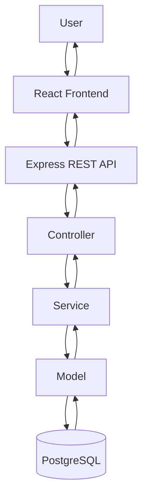
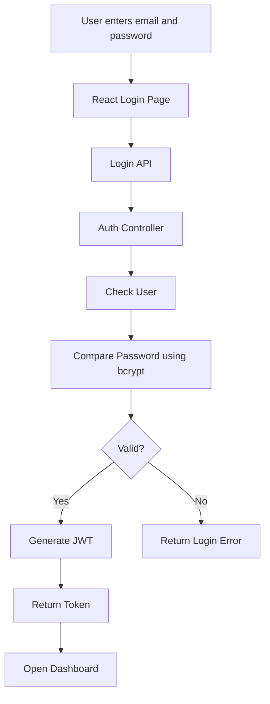
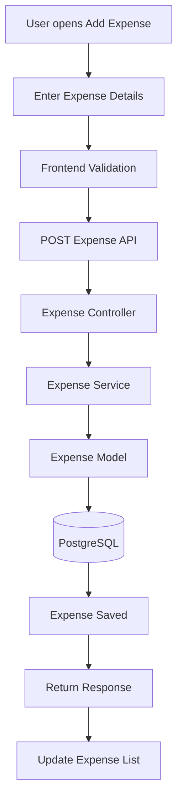
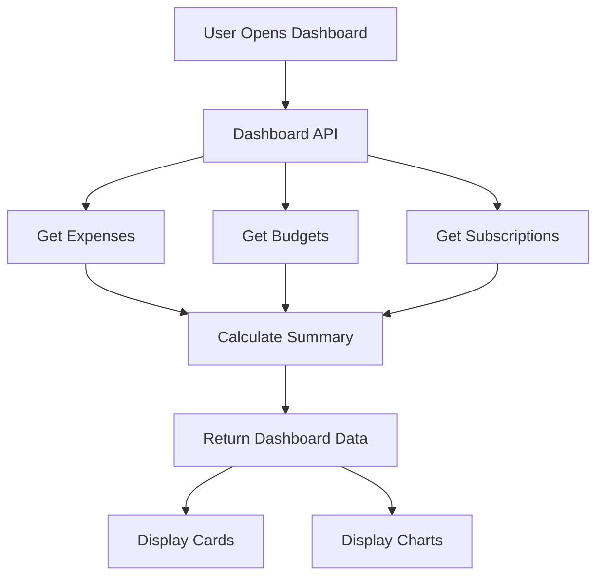
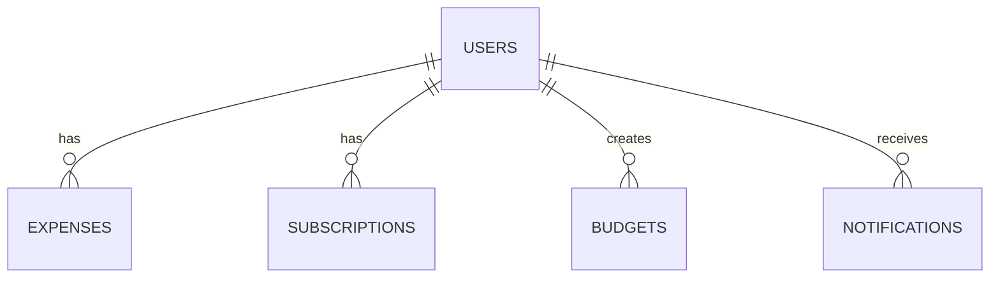

# Application Flow

This file explains how the application works step by step.

## Complete System Flow

This diagram shows the standard route-to-controller-to-service-to-model architecture used in the app.

## Login Flow

The login flow is the heart of security. Passwords are compared using bcrypt, and the backend creates a JWT only when the credentials are valid.

## Add Expense Flow

The form validates values before sending the request. The backend then checks the data and stores it in PostgreSQL.

## Dashboard Flow

The dashboard combines several data sources to show totals, remaining budget, and category trends.

## Database Flow

The database is designed so each user has their own expenses, subscriptions, budgets, and notifications.
